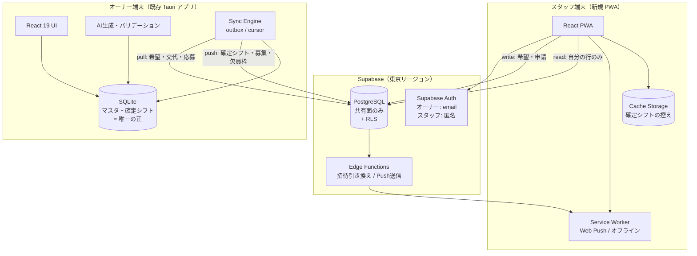
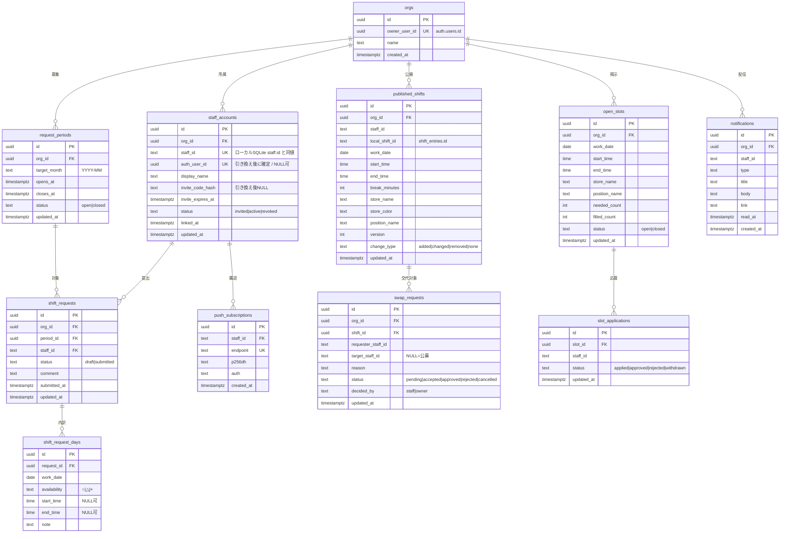
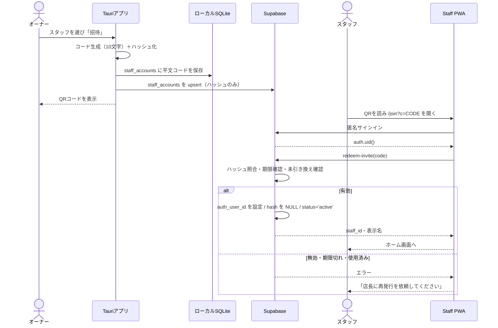
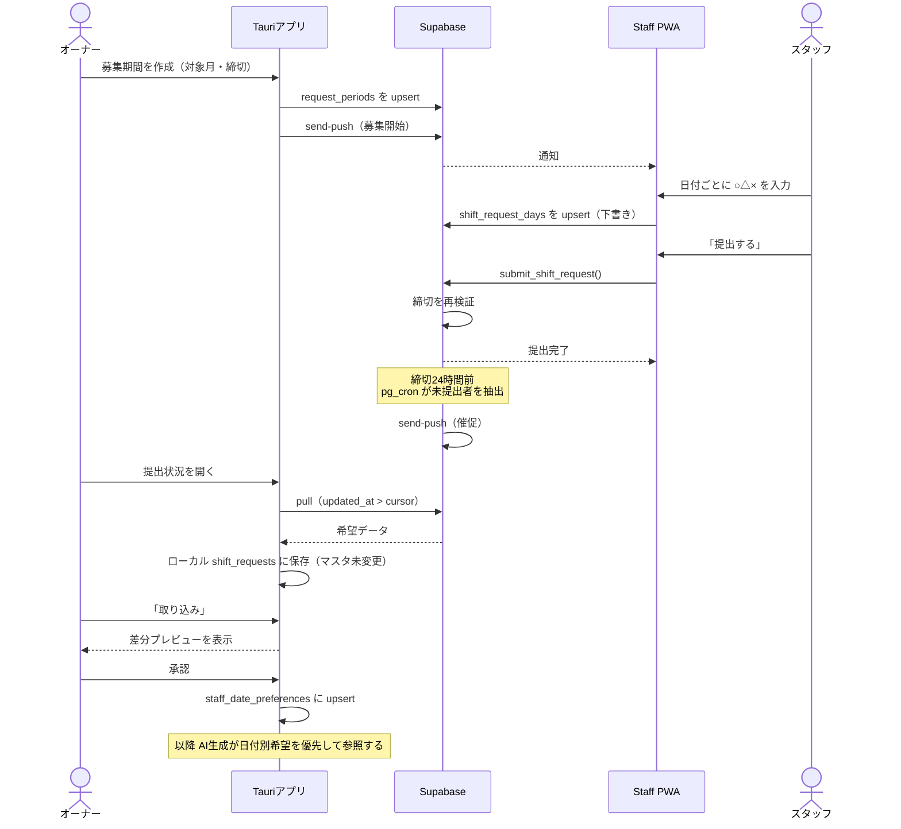
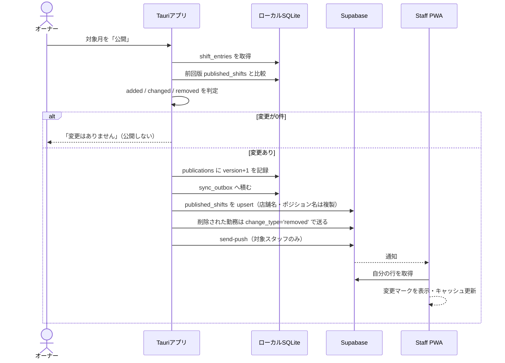
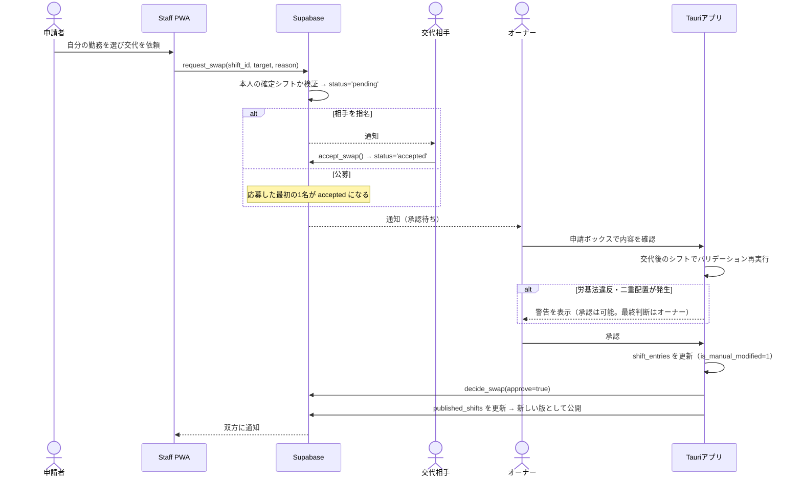

# システム設計書 — ShiftCraft 従業員アプリ（Phase 2 / Staff PWA）

- **対象アプリ**: ShiftCraft (Local-first) + Staff PWA（新規）
- **作成日**: 2026-09-08
- **ステータス**: 設計
- **関連**: `20260908_requirements_staff.md`（本件の要件定義）、`20260406_design_local.md`（基盤設計 v2.1）、`20260602_design_shift_learning.md`（傾向学習）

---

## 0. このドキュメントの意図（なぜ作るか）

要件定義 D-1〜D-3 で決めた「Supabase + RLS / PWA / 交代まで含むMVP」を、
既存の Tauri + SQLite アプリを壊さずに実装するための設計。

設計の中心にあるのは **競合を発生させないための書き込み権の分割** である。
双方向同期は競合解決が最大の複雑さになるが、本設計では
**1つのデータに書き込める主体を常に1つに限定する**ことで、クラウド側の競合解決を不要にする（§4.2）。

### 設計の鉄則

- **オーナー側の作業は決してクラウドに依存させない。** 同期が全て止まっても、マスタ管理・AI生成・バリデーション・PDF出力は従来どおり動く。クラウドは配布と回収のためのレイヤーに留める。
- **集めた希望を自動でマスタに反映しない。** 取り込みは必ずオーナーの承認を挟む。基盤の「嫌われないUI（強制ではなく警告）」をデータ取り込みにも適用する。
- **クラウドには共有に必要な最小限しか置かない。** 個人メモ・時給・目標時間・必要人員設定は同期対象に含めない。

---

## 1. アーキテクチャ

### 1.1 全体構成



### 1.2 責務分割（どこが「正」か）

| データ | 正（Single Source of Truth） | 理由 |
|--------|------------------------------|------|
| 店舗・ポジション・スタッフ・必要人員 | **ローカル SQLite** | 経営情報。共有不要。クラウドには名前だけ複製する |
| 確定シフト | **ローカル SQLite** | 生成とバリデーションがローカルで動くため。クラウド上のものは「公開された控え」 |
| 希望シフト・交代申請・ヘルプ応募 | **Supabase** | スタッフが起点で発生する。ローカルには取り込んだコピーを持つ |
| 通知 | Supabase | 配信のため |

### 1.3 リポジトリ構成

既存リポジトリ内にワークスペースを追加し、型とAPI契約を共有する。

```
shift-app/
├── src/                      # 既存: オーナー向け Tauri アプリ（変更は追記のみ）
│   ├── sync/                 # 【新規】同期エンジン
│   ├── components/staff-link/    # 【新規】招待・希望収集・公開・申請ボックス
│   └── db/queries/            # 【改修】希望・公開・申請のローカルクエリを追加
├── packages/
│   └── shared/               # 【新規】両クライアントが使う型・API契約・バリデータ
│       └── src/
│           ├── types.ts          # クラウド側テーブルの型（DBから生成）
│           └── contract.ts       # RPC名・引数・戻り値の定義
├── apps/
│   └── staff-pwa/            # 【新規】スタッフ向け PWA（Vite + React 19）
│       ├── src/
│       │   ├── pages/            # join / home / request / shifts / help / requests / settings
│       │   ├── lib/supabase.ts
│       │   └── sw.ts             # Service Worker（Push + オフラインキャッシュ）
│       └── vite.config.ts
└── supabase/                 # 【新規】
    ├── migrations/               # スキーマ・RLS
    └── functions/
        ├── redeem-invite/
        └── send-push/
```

> pnpm workspace を使う。既存の `src/` はパス構成を変えないため、現行のビルドとテストに影響しない。

---

## 2. データ設計

### 2.1 Supabase 側 ER 図



### 2.2 ローカル SQLite に追加するテーブル

既存テーブルは**一切変更しない**（`staff` 等へのカラム追加もしない）。追記のみで完結させる。

```sql
-- 同期状態
CREATE TABLE IF NOT EXISTS sync_state (
    key TEXT PRIMARY KEY,          -- 例: 'cursor.shift_requests'
    value TEXT NOT NULL
);

-- 送信待ちキュー（オフライン耐性）
CREATE TABLE IF NOT EXISTS sync_outbox (
    id TEXT PRIMARY KEY,
    entity TEXT NOT NULL,          -- published_shifts / open_slots / ...
    entity_id TEXT NOT NULL,
    op TEXT NOT NULL,              -- upsert | delete
    payload TEXT NOT NULL,         -- JSON
    attempts INTEGER DEFAULT 0,
    last_error TEXT,
    created_at TEXT DEFAULT (datetime('now'))
);

-- スタッフ連携状態（クラウド staff_accounts のミラー）
CREATE TABLE IF NOT EXISTS staff_accounts (
    staff_id TEXT PRIMARY KEY REFERENCES staff(id) ON DELETE CASCADE,
    remote_id TEXT,
    status TEXT NOT NULL DEFAULT 'invited',
    invite_code TEXT,              -- 平文はローカルのみ（QR再表示用）
    invite_expires_at TEXT,
    linked_at TEXT,
    updated_at TEXT DEFAULT (datetime('now'))
);

-- 募集期間
CREATE TABLE IF NOT EXISTS request_periods (
    id TEXT PRIMARY KEY,
    target_month TEXT NOT NULL,    -- YYYY-MM
    opens_at TEXT NOT NULL,
    closes_at TEXT NOT NULL,
    status TEXT NOT NULL DEFAULT 'open',
    updated_at TEXT DEFAULT (datetime('now'))
);

-- 回収した希望（取り込み前の受け皿。マスタではない）
CREATE TABLE IF NOT EXISTS shift_requests (
    id TEXT PRIMARY KEY,
    period_id TEXT NOT NULL REFERENCES request_periods(id) ON DELETE CASCADE,
    staff_id TEXT NOT NULL REFERENCES staff(id) ON DELETE CASCADE,
    status TEXT NOT NULL,
    comment TEXT,
    submitted_at TEXT,
    imported_at TEXT,              -- NULL = 未取り込み
    updated_at TEXT DEFAULT (datetime('now')),
    UNIQUE(period_id, staff_id)
);

CREATE TABLE IF NOT EXISTS shift_request_days (
    id TEXT PRIMARY KEY,
    request_id TEXT NOT NULL REFERENCES shift_requests(id) ON DELETE CASCADE,
    work_date TEXT NOT NULL,
    availability TEXT NOT NULL,    -- ○ | △ | ×
    start_time TEXT,
    end_time TEXT,
    note TEXT,
    UNIQUE(request_id, work_date)
);

-- 【中核】取り込み後の日付別希望。AI生成が参照する
CREATE TABLE IF NOT EXISTS staff_date_preferences (
    id TEXT PRIMARY KEY,
    staff_id TEXT NOT NULL REFERENCES staff(id) ON DELETE CASCADE,
    work_date TEXT NOT NULL,
    status TEXT NOT NULL,          -- ○ | △ | ×
    start_time TEXT,
    end_time TEXT,
    source TEXT NOT NULL DEFAULT 'staff_app',  -- staff_app | owner
    updated_at TEXT DEFAULT (datetime('now')),
    UNIQUE(staff_id, work_date)
);

-- 公開履歴（版管理）
CREATE TABLE IF NOT EXISTS publications (
    id TEXT PRIMARY KEY,
    target_month TEXT NOT NULL,
    version INTEGER NOT NULL,
    scope TEXT NOT NULL DEFAULT 'self',  -- self | store
    published_at TEXT DEFAULT (datetime('now')),
    UNIQUE(target_month, version)
);

-- 申請系のミラー
CREATE TABLE IF NOT EXISTS swap_requests (
    id TEXT PRIMARY KEY,
    shift_entry_id TEXT,
    requester_staff_id TEXT NOT NULL,
    target_staff_id TEXT,
    reason TEXT,
    status TEXT NOT NULL,
    updated_at TEXT DEFAULT (datetime('now'))
);

CREATE TABLE IF NOT EXISTS open_slots (
    id TEXT PRIMARY KEY,
    work_date TEXT NOT NULL,
    start_time TEXT NOT NULL,
    end_time TEXT NOT NULL,
    store_id TEXT REFERENCES stores(id) ON DELETE SET NULL,
    position_id TEXT REFERENCES positions(id) ON DELETE SET NULL,
    needed_count INTEGER NOT NULL DEFAULT 1,
    status TEXT NOT NULL DEFAULT 'open',
    updated_at TEXT DEFAULT (datetime('now'))
);

CREATE TABLE IF NOT EXISTS slot_applications (
    id TEXT PRIMARY KEY,
    slot_id TEXT NOT NULL REFERENCES open_slots(id) ON DELETE CASCADE,
    staff_id TEXT NOT NULL REFERENCES staff(id) ON DELETE CASCADE,
    status TEXT NOT NULL DEFAULT 'applied',
    updated_at TEXT DEFAULT (datetime('now'))
);
```

**追加方法**: `src/db/database.ts` の `SCHEMA` 定数に追記する。全て `CREATE TABLE IF NOT EXISTS` なので既存ユーザーのDBにも安全に適用される。カラム追加を伴わないため `migrateXxx()` 形式の移行関数は不要。

### 2.3 ID 戦略

- `staff.id`（ローカルの TEXT UUID）を**クラウドでもそのまま `staff_id` として使う**。マッピングテーブルを持たない。
- 確定シフトは `published_shifts.local_shift_id = shift_entries.id` で対応付ける。再公開時はこのキーで差分を判定する。
- クラウド固有のレコード（`shift_requests` 等）はクラウドで採番した UUID をローカルでもそのまま主キーにする。

---

## 3. 認証・認可

### 3.1 認証方式

| 主体 | 方式 | 備考 |
|------|------|------|
| オーナー | Supabase Auth（メール＋パスワード） | 既存のローカルパスワード画面（`useAuthStore`）とは別物。ローカルのロック解除は従来どおり残す |
| スタッフ | Supabase Auth **匿名サインイン** ＋ 招待コード引き換え | メール登録を求めない。端末に紐づく |

### 3.2 招待と引き換え

1. オーナーがスタッフを選び招待を発行 → ローカルで 10 文字のコードを生成
2. コードは **ハッシュのみ**をクラウドに送る（`invite_code_hash`）。平文はローカルとQRにのみ存在する
3. スタッフが QR（`https://<staff-app>/join?c=CODE`）を開く → 匿名サインイン
4. Edge Function `redeem-invite` にコードを送る
5. 関数側で `SECURITY DEFINER` により検証 → `auth_user_id` を設定し、`invite_code_hash` を NULL にして `status='active'` に更新

**引き換えは1回限り**。すでに `auth_user_id` が入っている行は引き換え不可。端末変更時はオーナーが再発行する（旧 `auth_user_id` は破棄）。

### 3.3 RLS ポリシー

全テーブルで `enable row level security` を有効にする。スタッフの `staff_id` は毎回サブクエリで解決する。

```sql
-- 現在のユーザーの staff_id を返すヘルパー
create or replace function current_staff_id() returns text
language sql stable security definer as $$
  select staff_id from staff_accounts
   where auth_user_id = auth.uid() and status = 'active'
   limit 1;
$$;

-- 確定シフト: 本人の行のみ読める。書き込みはオーナーのみ
create policy staff_read_own_shifts on published_shifts
  for select using ( staff_id = current_staff_id() );

create policy owner_manage_shifts on published_shifts
  for all using (
    org_id in (select id from orgs where owner_user_id = auth.uid())
  );

-- 希望: 本人が作成・更新できる。締切後は更新不可
create policy staff_write_own_request on shift_requests
  for all using ( staff_id = current_staff_id() )
  with check (
    staff_id = current_staff_id()
    and exists (
      select 1 from request_periods p
       where p.id = period_id and p.status = 'open' and now() < p.closes_at
    )
  );

-- 通知: 本人のみ読める。更新は read_at だけ（トリガで他列の変更を拒否）
create policy staff_read_own_notifications on notifications
  for select using ( staff_id = current_staff_id() );
```

`open_slots` と `request_periods` は同一 org のアクティブなスタッフ全員が読めるようにする。
`published_shifts` の公開範囲を「店舗全員」にする設定（要件 OF-08）を使う場合のみ、
`scope='store'` の版に限って同一店舗のスタッフに `select` を許可するポリシーを追加する。

### 3.4 鍵の取り扱い

| 鍵 | 置き場所 |
|----|---------|
| `anon key` | オーナーアプリ・PWA の両方に埋め込む（公開前提。RLS が防御線） |
| `service_role key` | **どちらにも置かない**。Edge Function の環境変数のみ |
| VAPID 秘密鍵 | Edge Function の環境変数のみ |

---

## 4. 同期設計

### 4.1 方向と単位

| 方向 | 対象 | 契機 |
|------|------|------|
| Push（オーナー→クラウド） | `published_shifts` / `request_periods` / `open_slots` / `staff_accounts` / `notifications` / 申請の `status` | 公開・招待・承認などの操作時に outbox へ積み、即時送信を試みる |
| Pull（クラウド→オーナー） | `shift_requests` / `shift_request_days` / `swap_requests` / `slot_applications` / 連携状態 | アプリ起動時、5分間隔のポーリング、手動更新ボタン |

同期単位は**レコード単位**。`updated_at > cursor` で差分を取り、`sync_state` にカーソルを保存する。

### 4.2 競合を発生させない書き込み権の分割

双方向同期の複雑さの大半は競合解決である。本設計は**列単位で書き込める主体を1つに固定**することで、これを構造的に回避する。

| テーブル | オーナーが書く | スタッフが書く |
|----------|--------------|--------------|
| `published_shifts` | 全列 | なし（読むだけ） |
| `request_periods` | 全列 | なし |
| `open_slots` | 全列 | なし |
| `shift_requests` / `_days` | なし（読むだけ） | 全列（締切前のみ） |
| `swap_requests` | `status`（承認/却下） | 作成・`status='accepted'`（指名された側の同意）・取り下げ |
| `slot_applications` | `status` | 作成・取り下げ |
| `notifications` | 作成 | `read_at` のみ |

この分割により、**同一の列に2者が同時に書く経路が存在しない**。
そのため基盤設計 5.3 の LWW ルールはクラウド同期には適用不要で、
ローカル内の従来ルール（`is_manual_modified` 優先等）だけが残る。

例外は `swap_requests.status` にオーナーとスタッフの両方が関与する点だが、
状態遷移を一方向（`pending → accepted → approved/rejected`）に限定し、
遷移は RPC 経由のみとして DB 側で不正遷移を拒否する（§5）。

### 4.3 送信キューとリトライ

- 送信失敗時は `sync_outbox.attempts` を加算し、指数バックオフ（1分・5分・15分・1時間）で再試行
- 5回失敗した項目はエラー表示に出し、手動再送を促す
- **オーナー側の操作は outbox への書き込み完了時点で成功扱い**にする。ネットワークを待たせない

### 4.4 希望の取り込みと生成への反映（既存コード改修）

これは本機能で唯一、既存の生成ロジックに触れる箇所である。

**取り込みフロー（OF-05）**
1. Pull で `shift_requests` / `shift_request_days` をローカルに保存する（この時点ではマスタに影響しない）
2. オーナーが「取り込み」を押すと、既存の `staff_date_preferences` との差分をプレビュー表示する
3. 承認すると `staff_date_preferences` に upsert し、`shift_requests.imported_at` を記録する

**生成への反映（OF-06）**

現行の `src/services/mock-ai-generator.ts` は曜日別の `staff_availability` を見ている。
ここに日付別の希望を優先させる解決関数を挟む。

```ts
// src/services/availability-resolver.ts【新規】
export function resolveAvailability(
  staff: StaffWithRelations,
  workDate: string,
  dayOfWeek: number
): AvailabilityStatus {
  const pref = staff.datePreferences?.find((p) => p.work_date === workDate);
  if (pref) return pref.status;                        // 日付別の希望を最優先
  return staff.availability.find((a) => a.day_of_week === dayOfWeek)?.status ?? "○";
}
```

| 改修対象 | 現行 | 変更後 |
|----------|------|--------|
| `src/db/queries/staff.ts:14-23` | `availability` / `ngDates` を読み込み | `staff_date_preferences` も読み込み `datePreferences` として付与 |
| `mock-ai-generator.ts:199` | `staff.availability.find(...)` で判定 | `resolveAvailability(...)` に置換 |
| `mock-ai-generator.ts:225-226` | 曜日別 availability でソート | 同上 |
| `mock-ai-generator.ts:189` | `ngDates` によるハード除外 | `ngDates` に加え `resolveAvailability(...) === "×"` も除外 |
| `src/types/index.ts` | — | `StaffDatePreference` を追加し `StaffWithRelations` を拡張 |

**`staff_ng_dates` との使い分け**: スタッフ提出の `×` は `staff_date_preferences`（`source='staff_app'`）に入れる。
オーナーが手動で登録する「絶対NG」は従来どおり `staff_ng_dates` に残す。
出所が異なるものを同じテーブルに混ぜると、再取り込み時にオーナーの入力を消しかねないため分離する。

---

## 5. API / RPC 設計

テーブルへの直接アクセス（PostgREST + RLS）を基本とし、
**状態遷移と権限昇格を伴うものだけ RPC / Edge Function** にする。

| 種別 | 名前 | 呼び出す側 | 内容 |
|------|------|-----------|------|
| Edge Function | `redeem-invite` | スタッフ | 招待コードを検証し `auth_user_id` を紐づける |
| Edge Function | `send-push` | オーナー / pg_cron | 対象スタッフへ Web Push を送信する |
| RPC | `submit_shift_request(request_id)` | スタッフ | `status='submitted'`、`submitted_at` を設定。締切を再検証 |
| RPC | `request_swap(shift_id, target_staff_id, reason)` | スタッフ | 交代申請を作成。自分の確定シフトであることを検証 |
| RPC | `accept_swap(swap_id)` | スタッフ | 指名された側の同意。`pending → accepted` のみ許可 |
| RPC | `decide_swap(swap_id, approve)` | オーナー | `accepted → approved/rejected` のみ許可 |
| RPC | `apply_slot(slot_id)` | スタッフ | 応募。`needed_count` 超過や重複応募を拒否 |
| RPC | `decide_application(app_id, approve)` | オーナー | 承認/却下。承認時に `filled_count` を加算 |
| RPC | `mark_notifications_read(ids)` | スタッフ | `read_at` のみ更新 |

直接テーブルを読む操作（一覧取得）は RPC を作らず RLS 付きの `select` で済ませる。

### レスポンスの扱い

- 締切超過・重複応募・不正な状態遷移は **RPC 側でエラーを返す**。クライアント側の検証だけに頼らない
- クライアントは楽観更新し、エラー時にロールバックして理由を表示する

---

## 6. 主要シーケンス

### 6.1 招待から参加まで



### 6.2 希望提出から取り込みまで



### 6.3 公開（確定シフトの配布）



> 変更が0件なら公開しない。基盤の運用方針である「変化が無ければ書かない」を踏襲し、無意味な通知でスタッフの通知許可を失わないようにする。

### 6.4 交代申請



> 承認時に `is_manual_modified = 1` を立てる。これにより AI 再生成で交代結果が上書きされない（既存の手動保護の仕組みをそのまま使う）。
> 同時に、傾向学習（`20260602_design_shift_learning.md`）が交代結果を教師信号として拾う副次効果もある。

---

## 7. 通知設計

| 通知 | 契機 | 送り先 |
|------|------|--------|
| 募集開始 | 募集期間の作成 | 対象スタッフ全員 |
| 提出リマインド | 締切24時間前（pg_cron） | 未提出者のみ |
| シフト公開 | 公開操作（変更がある場合のみ） | 変更のあったスタッフのみ |
| 交代の依頼／同意／結果 | 状態遷移 | 関係者のみ |
| ヘルプ募集 | `open_slots` の作成 | 対象店舗のスタッフ |

- 実装は Web Push（VAPID）。Service Worker が受信し、`link` で該当画面へ遷移させる
- **iOS 対応**: ホーム画面に追加されていないと Push を購読できない。初回起動時に追加手順を案内し、未追加の間はアプリ内バッジで代替する
- 通知が許可されていないスタッフには、次回アプリを開いた時にホームで未読を表示する（通知に依存しない導線を必ず用意する）

---

## 8. PWA 設計

| 項目 | 方針 |
|------|------|
| ビルド | Vite + `vite-plugin-pwa`。既存アプリと同じ React 19 / TypeScript / Tailwind 4 / shadcn/ui を使う |
| インストール | `manifest.json` に `display: standalone`。参加直後にホーム画面追加を案内する |
| キャッシュ | アプリシェルは Cache First。確定シフトは Network First（失敗時キャッシュ）。希望の下書きは IndexedDB |
| オフライン | 圏外でも直近の確定シフトを閲覧できる。提出操作は再送キューに積み、復帰時に自動送信する |
| 状態管理 | Zustand（オーナー側と同じ）。`packages/shared` の型を共有する |
| 認証の保持 | Supabase の匿名セッションを `localStorage` に保持。失効時は静かに再取得を試み、失敗時のみ再参加を促す |

---

## 9. セキュリティ設計

| 項目 | 対策 |
|------|------|
| 他人のデータ閲覧 | RLS で `staff_id = current_staff_id()` に限定。**受け入れテストで、別スタッフのトークンを使い全テーブルに対して 0 件が返ることを確認する** |
| 招待コードの総当たり | 10文字（英数36進で約 3.6×10^15 通り）＋有効期限7日＋引き換え1回限り。Edge Function 側で IP 単位のレート制限 |
| コードの保管 | クラウドにはハッシュのみ。平文はオーナーのローカルDBとQRにのみ存在する |
| 退職者の遮断 | `status='revoked'` にすると `current_staff_id()` が NULL を返し、全ての行が見えなくなる |
| 鍵の混入 | `service_role key` と VAPID 秘密鍵はリポジトリとクライアントバンドルに含めない。CI で検出する |
| 通信 | HTTPS のみ。PWA は HTTPS 必須のため実質強制される |
| 保存データ | クラウド側は §8.2（要件定義）の境界に従い、共有に不要な列を持たない |
| 監査 | 申請の承認・却下は `swap_requests.updated_at` と `decided_by` に残る |

---

## 10. エッジケースと対応

| ケース | 対応 |
|--------|------|
| 締切直後に提出が届いた | RPC が拒否。スタッフには「店長に連絡してください」を表示。オーナー側では手入力で対応 |
| 取り込み後にスタッフが希望を修正した | 締切前なら再取り込み可能。差分プレビューに「取り込み済みから変更あり」を明示する |
| 交代承認後に元のスタッフが復帰したい | 逆向きの交代申請を新規に出す。取り消しではなく新しい申請として扱う |
| 公開後にシフトを削除した | `change_type='removed'` で送信し、スタッフ側は取り消し線で表示してから翌日に消す |
| スタッフの端末紛失 | オーナーが `revoked` にして招待を再発行。旧セッションは即座に何も見えなくなる |
| 同じ枠に複数人が同時応募 | `apply_slot` RPC 内で `needed_count` を超える応募を拒否。先着で確定する |
| オーナーがオフラインのまま公開操作 | outbox に積まれ、オンライン復帰時に自動送信。UI には「未送信 n 件」を表示 |
| クラウド障害 | オーナー側は全機能が従来どおり動く。スタッフはキャッシュ済みシフトの閲覧のみ |
| スタッフ削除（ローカル） | `staff_accounts` を `revoked` にし、クラウド上の希望・申請は残す（履歴のため）。確定シフトは削除する |

---

## 11. 実装計画

### 11.1 新規ファイル

| パス | 内容 |
|------|------|
| `supabase/migrations/0001_init.sql` | テーブル・RLS・ヘルパー関数 |
| `supabase/migrations/0002_rpc.sql` | §5 の RPC 群 |
| `supabase/functions/redeem-invite/index.ts` | 招待引き換え |
| `supabase/functions/send-push/index.ts` | Web Push 送信 |
| `packages/shared/src/types.ts` | クラウド側の型（`supabase gen types` で生成） |
| `packages/shared/src/contract.ts` | RPC の引数・戻り値の定義 |
| `src/sync/engine.ts` | push / pull / outbox / cursor |
| `src/sync/mappers.ts` | ローカル ⇄ クラウドの変換 |
| `src/services/availability-resolver.ts` | §4.4 の解決関数 |
| `src/components/staff-link/InvitePage.tsx` | 招待QR発行・連携状態 |
| `src/components/staff-link/RequestCollectionPage.tsx` | 募集期間・提出状況・催促・取り込み |
| `src/components/staff-link/PublishPage.tsx` | 公開・履歴・版差分 |
| `src/components/staff-link/RequestInbox.tsx` | 交代/応募の承認 |
| `apps/staff-pwa/**` | スタッフ向け PWA 一式 |

### 11.2 改修ファイル

| パス | 変更 |
|------|------|
| `src/db/database.ts` | `SCHEMA` に §2.2 のテーブルを追記 |
| `src/db/queries/staff.ts` | `staff_date_preferences` を読み込み `datePreferences` を付与 |
| `src/services/mock-ai-generator.ts` | 3箇所を `resolveAvailability()` に置換（§4.4） |
| `src/types/index.ts` | `StaffDatePreference` 追加、`StaffWithRelations` 拡張 |
| `src/components/layout/Sidebar.tsx` | 新規4画面への導線を追加 |
| `README.md` | Design Principles の改訂（要件定義 §8.1）。**リリース必須** |
| `docs/20260414_overview_for_owner.md` | データの取り扱いの説明を改訂。**リリース必須** |

### 11.3 実装順序

要件定義 §9 のフェーズに対応する。各段階で動作確認できる単位に切っている。

1. **2-a-1** Supabase スキーマ + RLS + 招待/引き換え + 同期エンジンの骨格
   - 完了条件: 別スタッフのトークンで全テーブルが 0 件になることをテストで確認
2. **2-a-2** 募集期間・希望提出・提出状況・催促・取り込み・生成反映
   - 完了条件: 1か月分の希望を転記なしで生成に反映できる
3. **2-a-3** 公開・版管理・変更マーク・Web Push
4. **2-a-4** 交代・ヘルプ・承認・バリデーション再実行

### 11.4 テスト方針

既存の Vitest 構成（`vitest.config.ts`）に追加する。

| 対象 | 種別 | 内容 |
|------|------|------|
| `availability-resolver` | ユニット | 日付別希望が曜日別より優先されること、未設定時のフォールバック |
| `mock-ai-generator` | ユニット | 日付別 `×` が除外されること。既存テストが `datePreferences` 未指定で通ること（後方互換） |
| 同期エンジン | ユニット | outbox のリトライ、カーソル前進、重複 upsert の冪等性 |
| RLS | 結合 | スタッフA のトークンでスタッフB の行が取得できないこと（全テーブル） |
| RPC | 結合 | 締切後の提出拒否、不正な状態遷移の拒否、応募の定員超過拒否 |

---

## 12. 自己監査（Audit）

- ✅ **要件との整合**: 要件定義の SF-01〜11 / OF-01〜11 が §5・§6・§11 のいずれかに対応している。
- ✅ **現行スタックで実装可能**: React 19 / TypeScript / Zustand / Tailwind をそのまま使う。新規依存は Supabase クライアントと `vite-plugin-pwa` のみ。
- ✅ **既存スキーマを破壊しない**: 追加は `CREATE TABLE IF NOT EXISTS` のみ。既存テーブルへのカラム追加なし。移行関数も不要。
- ✅ **既存コードへの影響を限定**: 生成ロジックの変更は3箇所の置換に収まり、`datePreferences` が空なら現行と完全に同じ挙動になる（後方互換）。
- ✅ **競合解決の複雑さを回避**: §4.2 の書き込み権分割により、クラウド側で LWW もマージも不要にした。
- ✅ **Local-first の実利を維持**: クラウド障害時もオーナー側は全機能が動く。同期は付加物であって前提ではない。
- ⚠️ **原則の後退を伴う**: サーバー側にスタッフの希望と確定シフトが平文で載る。README とオーナー向け資料の改訂を §11.2 でリリース必須としたが、**これを行わずに公開すると説明と実態が食い違う**。
- ⚠️ **RLS の検証が生命線**: RLS の穴がそのまま他人のシフト漏洩になる。§11.4 の結合テストは実装前に用意し、テーブル追加のたびに必ず追加する。
- ⚠️ **iOS の通知到達率が未知数**: ホーム画面追加を経ないと Push が使えないため、実運用の到達率次第では要件 §9 の 2-b（ネイティブ化）が前倒しになる可能性がある。
- ⚠️ **匿名認証の復旧手段が招待再発行のみ**: 端末を替えるたびにオーナーの操作が要る。運用で重ければ、任意のメール登録による復旧を後続で追加する。
- ⚠️ **未検証の前提**: Supabase 無料枠の上限（帯域・行数）に対する実測を行っていない。2-a-1 完了時点で 50 名 × 1 か月の負荷を試算・実測すること。
