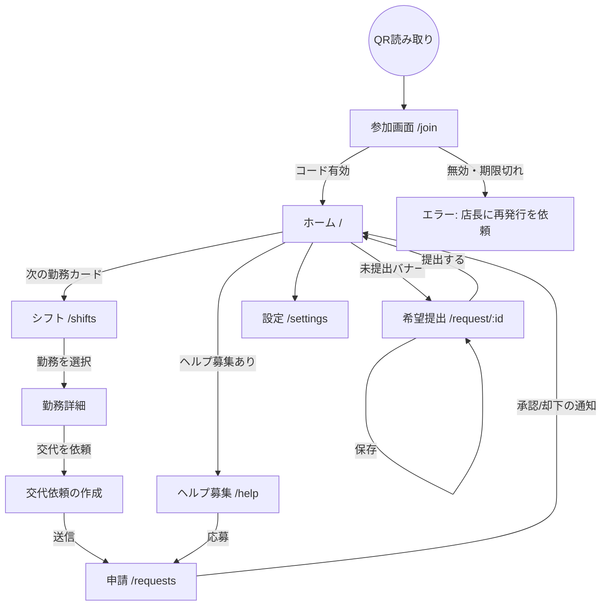
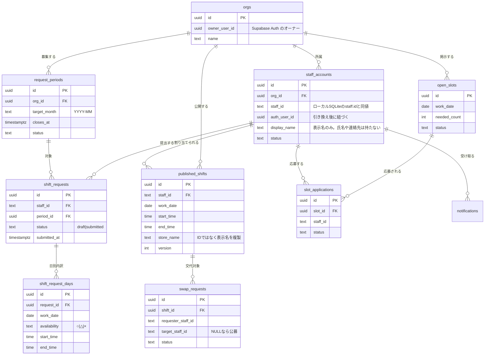

# 要件定義書 — ShiftCraft 従業員アプリ（Phase 2 / Staff PWA）

- **対象アプリ**: ShiftCraft (Local-first) + Staff PWA（新規）
- **作成日**: 2026-09-08
- **ステータス**: 要件定義
- **関連**: `20260406_requirements_local.md`（基盤要件 v2.1）、`20260406_design_local.md`（基盤設計）、`20260908_design_staff.md`（本件の設計書）

---

## 0. このドキュメントの意図（なぜ作るか）

現在の ShiftCraft は **オーナー1人が自分のPCで完結する**アプリである。
そのため、シフト運用の工程のうち以下がアプリの外に取り残されている。

| 工程 | 現状 | 誰の手間になっているか |
|------|------|----------------------|
| 希望シフトの収集 | LINE・紙・口頭 | オーナーが転記する |
| 未提出者への催促 | オーナーが個別に連絡 | オーナー |
| 確定シフトの配布 | PDFを印刷して掲示／画像で送信 | オーナー |
| 変更の周知 | 個別連絡 | オーナー |
| 交代・欠員の調整 | LINEグループで募集 | オーナー |

市場リサーチ（`~/HQ/docs/20260908_シフトアプリ機能一覧.md`）で確認したとおり、
**「シフト作成に時間がかかる」の主因は作表そのものではなく、希望を集めて転記する前工程**にある。
ここをアプリに載せない限り、AI自動生成をどれだけ磨いてもオーナーの総作業時間は減らない。

本ドキュメントは、従業員（スタッフ）側のクライアントを追加し、
**希望提出から確定配布・交代調整までをアプリ内で閉じる**ための要件を定義する。

---

## 1. 前提となる設計判断（Decisions）

本機能は基盤設計の前提を一部変更する。判断とその理由を先に明示する。

### D-1. 同期モデル: **Supabase + RLS（サーバー側は平文保持）**

| 案 | 採否 | 理由 |
|----|------|------|
| **Supabase + Row Level Security** | ✅ 採用 | 実装が最短。RLSで他人の行を遮断できる。機能追加（検索・集計・通知）が自由に組める |
| ハイブリッドE2EE（受信者別暗号化） | ✗ 不採用 | Zero Knowledge は維持できるが、鍵配布・端末変更時のリカバリ・鍵紛失時の復旧が MVP には重い |
| オーナーPCをサーバー化（Tailscale等） | ✗ 不採用 | オーナーのPCが起動していない間、全スタッフが何も見られない。可用性が実運用に耐えない |

> **重要**: この決定により、基盤要件 7.1 の「E2EE」および README の Design Principle
> 「Zero Knowledge — サーバーには暗号化済みバイナリしか渡さない」は **本フェーズでは成立しない**。
> 代替として §8「原則の改訂」でデータ最小化の原則を定義し、README の記述も改訂する。
> 訴求文言を修正しないまま出すと事実と異なる説明になるため、リリース前の必須作業とする。

### D-2. クライアント: **PWA（ブラウザ）**

| 案 | 採否 | 理由 |
|----|------|------|
| **PWA** | ✅ 採用 | QRを読めばその場で使える。ストア審査なし・更新が即時反映。アルバイトに専用アプリを入れさせる摩擦を回避できる |
| Expo / React Native | ✗ 今回不採用 | 通知は確実だが、ストア審査と各自のインストール作業が離脱点になる。将来 §9 Phase 2-b で再検討 |

- 制約として **iOS の Web Push はホーム画面追加が条件**。この制約は UI 側で吸収する（§5.1 SF-08）。
- 将来ネイティブ化する場合に UI 層を流用できるよう、**React + 同一 API 契約**で構成する。

### D-3. MVP範囲: **希望提出＋確定閲覧＋通知＋交代/欠員ヘルプ**

打刻・勤怠は **含めない**。KING OF TIME が月300円で全機能込みという領域であり、
後発が正面から取りに行く価値が薄いと判断した（市場リサーチ §G）。

---

## 2. ターゲットユーザーと提供価値

| 役割 | 誰か | 提供価値 |
|------|------|----------|
| **オーナー**（既存） | 飲食・小売の店長／個人事業主 | 希望の転記作業がゼロになる。催促を自動化できる。配布と変更周知が1操作で終わる |
| **スタッフ**（新規） | アルバイト・パート従業員 | 自分のシフトをいつでも確認できる。希望をスマホから出せる。交代相手をアプリ内で探せる |

**提供価値の要点**: 他社の店舗向けSaaSはスタッフ側アプリを持つのが当たり前だが、
ShiftCraft は「マスタと生成はオーナーのPCで完結し、**共有が必要な最小限だけをクラウドに出す**」という
データの持ち方で差別化する（§8）。

---

## 3. ユーザーストーリー

| No | 役割 | 目的 | 理由 | 優先度 |
|----|------|------|------|--------|
| US-01 | スタッフ | QRを読むだけで参加したい | アカウント作成やアプリ導入で脱落したくない | 必須 |
| US-02 | スタッフ | 来月の希望シフトをスマホから出したい | LINEで送るのは面倒で、送ったか忘れる | 必須 |
| US-03 | スタッフ | 確定したシフトをいつでも見たい | 紙の写真を探すのが面倒。予定が組めない | 必須 |
| US-04 | スタッフ | シフトが確定・変更されたら通知が欲しい | 見落として無断欠勤したくない | 必須 |
| US-05 | スタッフ | 都合が悪くなった日を交代してもらいたい | 店長に電話するのは気が重い | 必須 |
| US-06 | スタッフ | 人が足りない枠に自分から入りたい | もう少し稼ぎたい日がある | 必須 |
| US-07 | オーナー | 希望の提出状況を一覧で見たい | 誰が出していないか把握できないと作成に入れない | 必須 |
| US-08 | オーナー | 未提出者にまとめて催促したい | 1人ずつ連絡するのが一番の手間 | 必須 |
| US-09 | オーナー | 集まった希望をシフト生成に反映したい | 転記作業をなくすことが本機能の目的 | 必須 |
| US-10 | オーナー | 確定シフトを全員に公開したい | 印刷・撮影・送信の手間をなくす | 必須 |
| US-11 | オーナー | 交代申請とヘルプ応募を承認/却下したい | 勝手に入れ替わると人員要件が崩れる | 必須 |
| US-12 | オーナー | スタッフに見せる情報を絞りたい | 他人の勤務状況や個人メモを見せたくない | 必須 |
| US-13 | スタッフ | 今月の勤務時間の合計を見たい | 扶養の範囲を超えたくない | 任意 |
| US-14 | オーナー | 誰がいつ確認したか知りたい | 「見ていない」を防ぎたい | 任意 |

---

## 4. 機能要件

### 4.1 スタッフ側（PWA）— MVP

| ID | 機能 | 内容 |
|----|------|------|
| SF-01 | 参加（招待引き換え） | QRまたは招待コードで参加。氏名等の入力なし。端末に紐づけて以後は自動ログイン |
| SF-02 | ホーム | 次の勤務、未提出の募集、未読のお知らせを1画面に集約 |
| SF-03 | 希望シフト提出 | 対象月のカレンダーで日別に ○（出勤可）/ △（できれば避けたい）/ ×（不可）を選択。○△には希望時間帯を任意で付けられる。自由コメント欄あり |
| SF-04 | 提出内容の修正 | 締切前なら何度でも修正できる。締切後はオーナーに依頼する導線を出す |
| SF-05 | 確定シフト閲覧 | 自分の確定シフトを月表示／リスト表示。店舗・ポジション・時間・休憩を表示 |
| SF-06 | 変更の可視化 | 前回公開分から変わった日にマークを付ける |
| SF-07 | 交代依頼 | 自分の確定シフトを選び、理由を添えて交代を依頼。相手を指名 or 全員に公募 |
| SF-08 | ヘルプ応募 | オーナーが出した欠員枠の一覧を見て、応募する |
| SF-09 | 通知 | 募集開始・締切リマインド・シフト公開・変更・申請の結果を通知。Web Push（iOSはホーム画面追加を促す案内を表示） |
| SF-10 | 勤務時間の合計表示 | 当月の確定シフトの合計時間を表示（任意・US-13） |
| SF-11 | 設定 | 表示名の変更、通知のON/OFF、端末の解除 |

### 4.2 オーナー側（Tauri アプリへの追加）— MVP

| ID | 機能 | 内容 |
|----|------|------|
| OF-01 | スタッフ招待 | スタッフごとに招待QR/コードを発行。有効期限あり。連携状態を一覧表示 |
| OF-02 | 募集期間の作成 | 対象月・提出開始日・締切日時を設定して募集を開始する |
| OF-03 | 提出状況の一覧 | 誰が提出済み／未提出かを一覧。締切までの残日数を表示 |
| OF-04 | 一括催促 | 未提出者にまとめて通知を送る。締切前の自動リマインドも設定可 |
| OF-05 | 希望の取り込み | 集まった希望をローカルDBに取り込む。**自動反映はせず**、差分をプレビューしてオーナーが承認する |
| OF-06 | 生成への反映 | 取り込んだ日別希望を、既存の曜日別 `staff_availability` より優先してシフト生成に使う |
| OF-07 | シフトの公開 | 確定シフトをスタッフへ配布する。公開単位は「対象月 × 版」。再公開すると差分が通知される |
| OF-08 | 公開範囲の制御 | スタッフに見せるのは本人の勤務のみか、店舗全員分かを設定で選べる（既定: 本人のみ） |
| OF-09 | 欠員枠の掲示 | 埋まらない枠を「ヘルプ募集」として掲示する |
| OF-10 | 申請の承認 | 交代申請・ヘルプ応募を承認/却下する。承認時にシフトへ自動反映し、バリデーションを再実行する |
| OF-11 | 同期状態の表示 | 最終同期時刻、未送信件数、エラーを表示。手動同期ボタン |

### 4.3 MVPに含めないもの

- 打刻・勤怠実績の管理（D-3）
- 給与計算・人件費のスタッフ向け表示
- スタッフ同士のチャット・メッセージ機能
- 複数オーナー／本部アカウントによる多店舗横断管理
- 扶養・年収の壁の自動制御（表示のみ。制御は将来）

---

## 5. 画面設計

### 5.1 画面一覧

**スタッフ側（PWA）**

| 画面 | パス | 概要 |
|------|------|------|
| 参加 | `/join` | 招待コード引き換え |
| ホーム | `/` | 次の勤務・未提出・お知らせ |
| 希望提出 | `/request/:periodId` | 月カレンダーで ○△× を入力 |
| シフト | `/shifts` | 確定シフトの月表示／リスト |
| ヘルプ募集 | `/help` | 欠員枠一覧と応募 |
| 申請 | `/requests` | 自分の交代依頼・応募の状態 |
| 設定 | `/settings` | 表示名・通知・端末解除 |

**オーナー側（Tauri／既存サイドバーに追加）**

| 画面 | 概要 |
|------|------|
| スタッフ連携 | 招待QR発行・連携状態一覧 |
| 希望収集 | 募集期間の作成・提出状況・催促・取り込み |
| 公開管理 | 公開操作・公開履歴・版差分 |
| 申請ボックス | 交代/ヘルプ申請の承認・却下 |

### 5.2 画面遷移図（スタッフ側）

### 5.3 主要画面の構成

**希望提出（`/request/:periodId`）**
- 主要要素: 対象月の日付グリッド、○/△/× のトグル、時間帯入力（任意）、コメント欄、締切までの残り時間、提出ボタン
- アクション: 日付タップで状態を循環（○→△→×→未設定）、長押しで時間帯を指定、一括操作（「毎週土日を×にする」など）
- 状態: 未提出 / 下書き保存済み / 提出済み（締切前は再編集可）/ 締切後（閲覧のみ）

**シフト（`/shifts`）**
- 主要要素: 月カレンダー（自分の勤務のみ色付き）、リスト表示切替、当月合計時間、前回公開からの変更マーク
- アクション: 勤務をタップ→詳細→交代依頼

**ホーム（`/`）**
- 主要要素: 次の勤務（日時・店舗・ポジション）、未提出アラート（締切までの残り）、お知らせ一覧、ヘルプ募集の件数バッジ

---

## 6. データモデル（概念ER図）

クラウド側に置くデータのみを示す。オーナー側マスタの全量は同期しない（§8）。

---

## 7. 非機能要件

| 区分 | 要件 |
|------|------|
| **想定規模** | 1オーナーあたりスタッフ 5〜50名、店舗 1〜5。Supabase 無料枠で収まる範囲を上限設計とする |
| **パフォーマンス** | スタッフ側の初回表示 2秒以内（3G相当）。希望提出の保存は楽観更新で即座に反映 |
| **オフライン** | PWAは確定シフトをキャッシュし、圏外でも直近の確定シフトを閲覧できる。希望提出は再送キューに積む |
| **可用性** | Supabase 障害時、スタッフは閲覧のみ継続。オーナー側はローカルDBのみで従来どおり全機能が動く（**オーナー側の作業がクラウドに依存しないことを維持する**） |
| **セキュリティ** | 全テーブルで RLS 必須。Service Role Key はクライアントに配置しない。スタッフは他人の行を一切取得できないこと（§9 の受け入れ条件で検証） |
| **データ所在** | Supabase のリージョンは東京（`ap-northeast-1`）を選択する。従業者情報の越境移転を避けるため |
| **端末** | iOS 16.4+ / Android Chrome 最新2バージョン。iOS の Web Push はホーム画面追加が前提 |
| **アクセシビリティ** | ○△× は色だけで区別しない（記号を併記）。タップ領域 44px 以上 |

---

## 8. 原則の改訂とリスク

### 8.1 Local-first 原則の再定義

D-1 により、README の Design Principles は次のとおり改訂が必要になる。

| 原則 | 現行 | 改訂後 |
|------|------|--------|
| Local-first | データは手元のSQLiteにのみ存在 | **マスタと生成は手元のSQLiteで完結する。クラウドに出すのは共有が必要な最小限のみ** |
| Zero Knowledge | サーバーには暗号化済みバイナリしか渡さない | **（本フェーズでは撤回）** 代わりに「データ最小化」を採用。将来 E2EE 化する場合の余地は残す |
| 匿名化AI | 変更なし | 変更なし |
| 嫌われないUI | 変更なし | 変更なし（希望の自動反映をしない設計に継承 / OF-05） |

### 8.2 クラウドに出す / 出さないの境界

| データ | クラウド | 理由 |
|--------|---------|------|
| 表示名、確定シフト、希望、交代/応募 | 出す | 共有が目的のデータ |
| 店舗名・ポジション名 | 出す（名前のみ複製） | シフト表示に必要。マスタ全体は同期しない |
| スタッフの個人メモ、目標/上限時間、時給、評価 | **出さない** | 共有の必要がなく、漏洩時の影響が大きい |
| 必要人員設定、店舗の営業時間、生成パラメータ | **出さない** | オーナー側の経営情報 |
| 氏名（フルネーム）、電話番号、住所、緊急連絡先 | **出さない** | そもそもアプリが保持しない。表示名で足りる |

### 8.3 リスク

| リスク | 影響 | 対応 |
|--------|------|------|
| 訴求文言と実態の乖離 | 「クラウドに出さない」と説明したまま出すと不正確な説明になる | リリース前に README・オーナー向け資料（`20260414_overview_for_owner.md`）を改訂する。**リリースの必須条件とする** |
| 従業者情報の取扱い | 個人情報保護法上、Supabase は委託先にあたる | 東京リージョンを選択。オーナー向けに「何が保存されるか」を明示する画面を用意する |
| スタッフの端末変更・紛失 | 匿名認証のため復旧手段がないと再参加できない | オーナーが招待を再発行できる導線を必須にする（OF-01）。旧端末は無効化する |
| 招待コードの流出 | 第三者が他人のシフトを閲覧できる | 1回限り・有効期限付き。引き換え後は即無効化。連携済み端末は1つに限定 |
| Supabase 無料枠の超過 | 同期停止 | 想定規模を明示（§7）。超過時はオーナー側のローカル機能が影響を受けない設計で被害を限定する |

---

## 9. フェーズとマイルストーン

| フェーズ | 内容 | 完了条件 |
|---------|------|---------|
| **2-a-1 基盤** | Supabase プロジェクト作成、スキーマ、RLS、招待/引き換え、同期基盤（送受信） | オーナーが招待したスタッフがログインでき、他人の行を1件も取得できないことをテストで確認 |
| **2-a-2 希望収集** | 募集期間、希望提出、提出状況、催促、取り込み（OF-05）、生成への反映（OF-06） | 1か月分の希望を、転記なしでシフト生成に反映できる |
| **2-a-3 配布** | 公開、版管理、変更マーク、通知 | オーナーが公開したシフトがスタッフ端末に届き、変更が識別できる |
| **2-a-4 調整** | 交代依頼、ヘルプ募集、承認、承認時のシフト反映とバリデーション再実行 | 交代がアプリ内で完結し、承認後のシフトが不正にならない |
| **2-b（判断）** | 通知到達率が実運用で不足する場合に Expo でネイティブ化 | PWA運用データを見て判断する |

---

## 10. 自己監査（Audit）

- ✅ **目的との整合**: 「希望を集めて転記する」というオーナー最大の手間を、OF-03〜OF-06 で解消する構成になっている。
- ✅ **既存スタックで実装可能**: React 19 + TypeScript を PWA 側でも使う。オーナー側は Tauri のまま。新規に必要なのは Supabase のみ。
- ✅ **既存原則との衝突を明示**: D-1 が README の Zero Knowledge と衝突する点を §8 で明記し、文言改訂をリリース必須条件に含めた。
- ✅ **「嫌われないUI」の継承**: 集めた希望を自動反映せず、オーナーが差分を承認する（OF-05）。強制ではなく確認ベースという基盤方針を踏襲している。
- ✅ **オーナー側の独立性維持**: クラウド障害時もローカル機能は全て動く（§7 可用性）。Local-first の実利部分は失われない。
- ⚠️ **スキーマ改修が必要**: 日付単位の希望を格納する受け皿が現行ローカルDBに無い。`staff_availability` は曜日単位のため、新テーブルとジェネレータ改修が要る（設計書 §2.2 / §4.4）。
- ⚠️ **iOS の通知制約**: ホーム画面追加を促す導線の出来が通知到達率を左右する。ここが弱いと 2-b（ネイティブ化）が前倒しで必要になる。
- ⚠️ **承認後の整合性**: 交代・ヘルプ承認でシフトが書き換わるため、承認時に既存バリデーション（休憩・二重配置・連勤）の再実行が必須。ここを飛ばすと不正なシフトが公開される。
